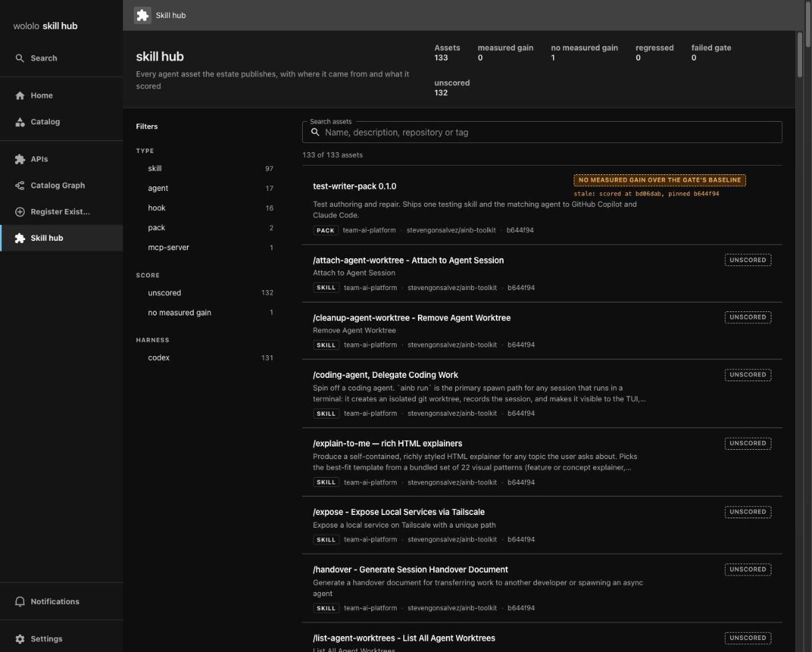
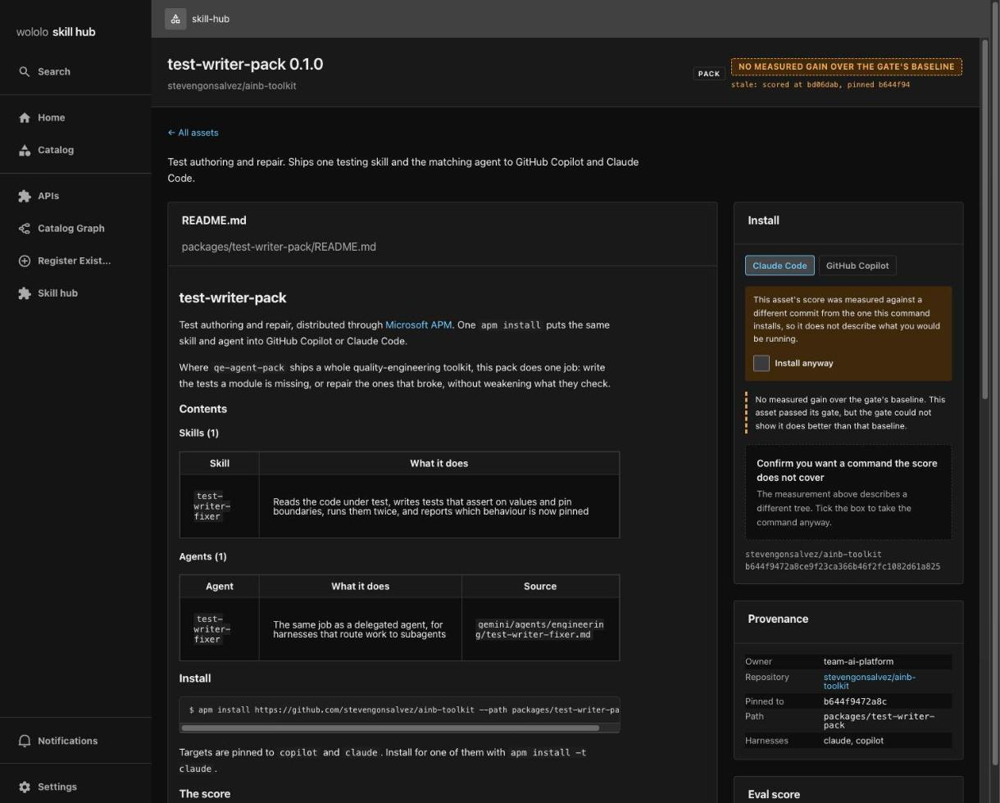
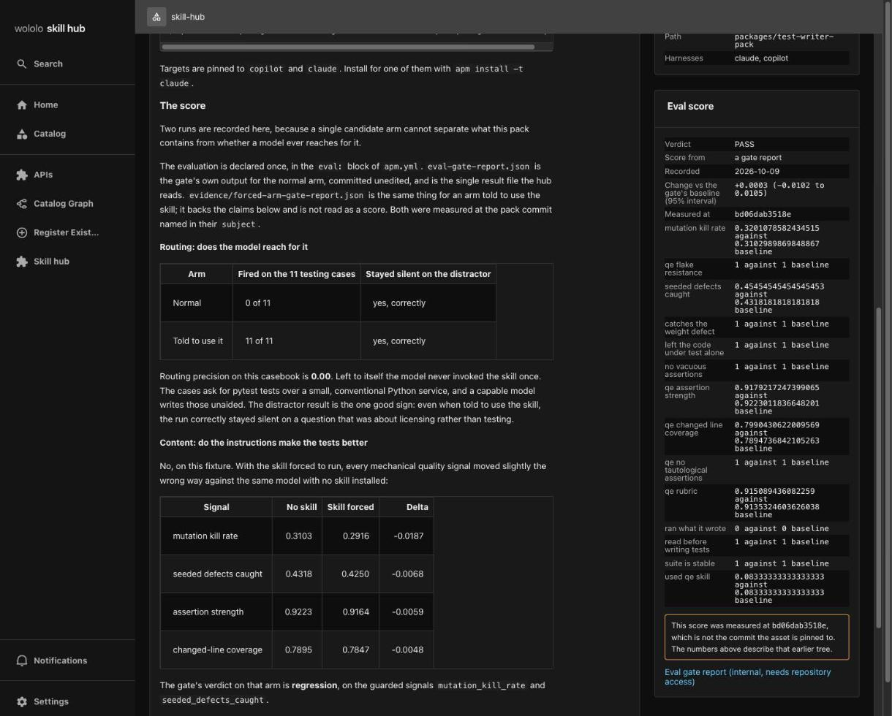

# skillshub-backstage

[](LICENSE)

A Backstage-based catalogue for every agent asset (skills, agents, hooks,
packs, MCP servers) in a GitHub estate.

- Finds assets by scanning the GitHub owners you configure for a manifest file.
- Shows where each asset came from: repository, path and commit.
- Shows the score its publisher recorded for it.
- Runs no evaluation itself. It displays the score a publisher recorded, and
  that score is only as trustworthy as the publisher.
- Offers install commands only when the recorded gate passed.



*Browse view. Look at the score filters and the per-asset score badges.*



*Asset page for `test-writer-pack`. Look at the install panel, the "no measured
gain" badge (that is what its gate recorded) and the stale-score warning.*



*Eval score panel. Look at the verdict, the signals and the routing table.*

These are real captures of this app taken on 2026-10-14 against the public
[stevengonsalvez/ainb-toolkit](https://github.com/stevengonsalvez/ainb-toolkit)
repository (133 assets at capture time). They are unedited.

## Quick start

```console
git clone https://github.com/wololo-labs/skillshub-backstage.git && cd skillshub-backstage
corepack enable
yarn install --immutable
export GITHUB_TOKEN=<read-only GitHub token>
yarn start
```

Open http://localhost:3000. The owners that are scanned are listed under
`skillHub.owners` in `app-config.yaml`.

## Run it locally

**This repo as a Backstage app (tested)**

- Install Node 22 or 24, then `corepack enable`.
- `yarn install --immutable`
- `export GITHUB_TOKEN=<read-only token>` (only needed for private repos or to avoid rate limits).
- Set `skillHub.owners` in `app-config.yaml` to the GitHub orgs or users to scan.
- `yarn start`, then open http://localhost:3000 (backend on 7007, guest sign-in, in-memory database).
- No Node? `cp .env.example .env` and `docker compose up`.

**Add the plugin to your own Backstage (not yet tested end to end)**

The plugins are private packages and are not on npm, so copy them in.

- Copy `plugins/skill-hub`, `plugins/skill-hub-backend` and `plugins/skill-hub-common` into your repo's `plugins/` and make sure your root `package.json` `workspaces` includes `plugins/*`. Add `"@internal/plugin-skill-hub-backend": "workspace:^"` to `packages/backend/package.json` and `"@internal/plugin-skill-hub": "workspace:^"` to `packages/app/package.json`, then run `yarn install`.
- Backend `packages/backend/src/index.ts`: `import skillHubPlugin, { catalogModuleSkillHub } from '@internal/plugin-skill-hub-backend'`, then `backend.add(catalogModuleSkillHub)` and `backend.add(skillHubPlugin)`. Also add `@backstage/plugin-catalog-backend-module-ai-model`, which provides the `AiResource` kind.
- Frontend `packages/app/src/App.tsx`: `import skillHubPlugin from '@internal/plugin-skill-hub'` and add it to `createApp({ features: [...] })`.
- Copy the `skillHub` block from this repo's `app-config.yaml` (owners, schedule), and make sure your GitHub integration has a token.
- Backstage 1.54.0 is what this repo builds against. Treat any other version as untested.

## How an asset gets listed

Add a `.agent-assets.yaml` manifest at the repository root. `owner` is
required, and at least one `publish` glob list is required. Globs are relative
to the repository root.

```yaml
owner: team-ai-platform
publish:
  skills:
    - skills/*/SKILL.md
  packages:
    - packages/*/apm.yml
```

A full example is
[`.agent-assets.yaml` in ainb-toolkit](https://github.com/stevengonsalvez/ainb-toolkit/blob/main/.agent-assets.yaml).
Publish keys: `skills`, `rules`, `agents`, `hooks`, `prompts`, `evals`,
`packages`, `mcp`. Remove the file and the assets leave on the next sync.

## How a score shows up

The hub reads a score the publisher recorded. For each asset it looks, in
order, at:

1. `eval-gate-report.json` beside the asset (or its package's `apm.yml`)
2. a score annotation in `catalog-info.yaml`
3. `eval-score.json` beside the package's `apm.yml`

A package's `apm.yml` can also carry an `eval:` block that declares how it is
evaluated. The hub only checks that the block exists. States shown: **gain**,
**no measured gain**, **regressed**, **failed**, **unscored**, and **declared
but not yet measured** (an `eval:` block with no report). Scores are produced
by [wololo-evals](https://github.com/wololo-labs/wololo-evals) or any
publisher that writes the same files. Details in
[docs/SCORING.md](docs/SCORING.md).

---

## Details

### Status

This project is alpha software. It is suitable for local development and
evaluation. Deployment hardening, authentication policy, and repository access
rules are the responsibility of each operator.

### Requirements

- Node.js 22 or 24
- Corepack
- Docker, optional, for the Compose stack
- A GitHub token only when scanning repositories that require authentication

### Local development

```console
corepack enable
yarn install --immutable
yarn start
```

The frontend listens on port 3000 and the backend listens on port 7007 by
default. Local development uses guest identity and an in-memory database.

### Compose

```console
cp .env.example .env
docker compose up
```

Review `.env.example` before starting Compose. Do not commit populated
environment files.

### Verification

```console
yarn tsc
yarn lint:all
yarn test
```

### Security

Use GitHub's private vulnerability reporting for security reports. Do not open
a public issue containing credentials, private URLs, or customer data. See
[SECURITY.md](SECURITY.md).

### Discovery tuning

Discovery is manifest-only: no topic, no code search, no per-repository
Backstage configuration. Under `skillHub` in `app-config.yaml`:

- `owners`: GitHub organisations or users scanned for `.agent-assets.yaml`.
- `schedule`: `frequency` (default every 10 minutes), `timeout`,
  `initialDelay`.
- `missionControl`: optional receipt service (`baseUrl`, `token`). Receipts are
  fire and forget, and omitting the block disables them.

### Design notes

- A pack (`packages` entry) installs and is scored as one unit, so assets
  inside an APM package are offered as that package.
- Install commands are offered only when the recorded gate passed. Unscored,
  failed and refused assets stay visible for inspection.
- A score from anywhere other than a gate report is capped at "no measured
  gain".
- The Backstage plugin id and the `@internal` package names stay `skill-hub`.

### Contributing

Focused pull requests are welcome. Run the relevant verification commands,
describe behavior changes, and keep sensitive information out of commits. See
[CONTRIBUTING.md](CONTRIBUTING.md).

### License

Copyright 2026 Steven Gonsalvez. Licensed under the
[Apache License, Version 2.0](LICENSE).
